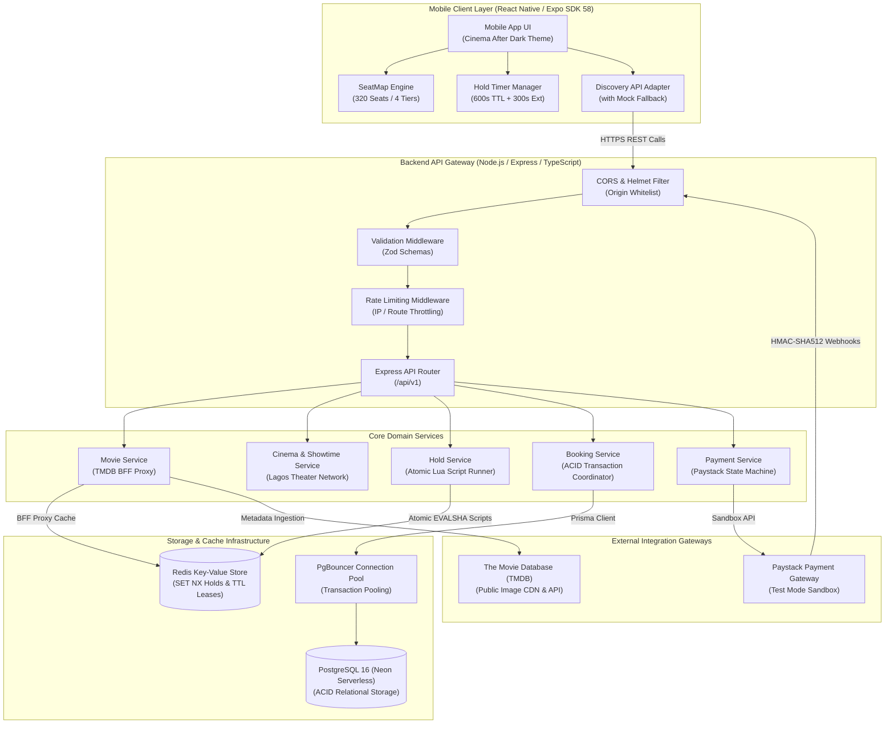
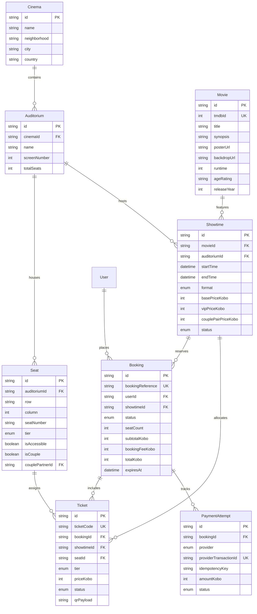
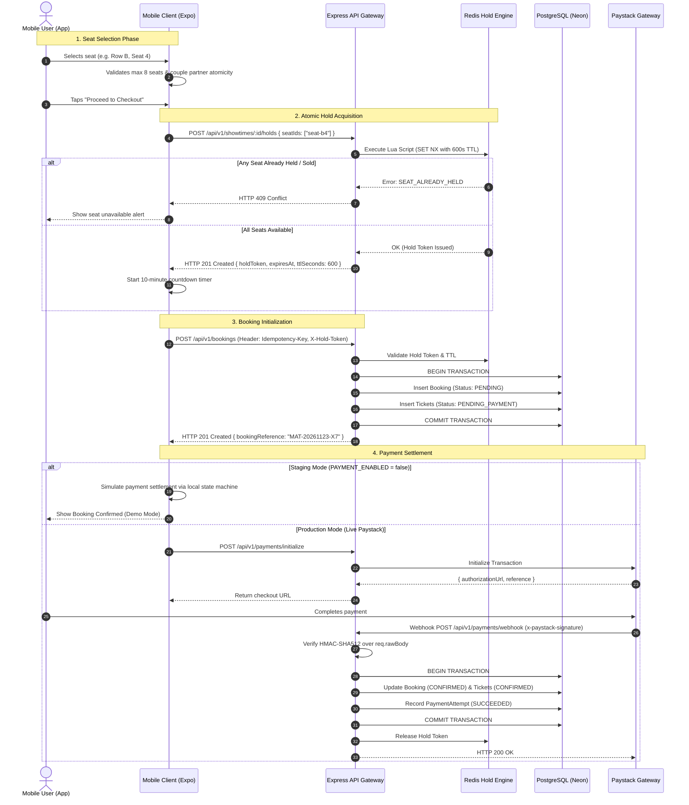

# Matinee: System Architecture & Technical Specifications

---

## 1. System Overview & Runtime Topology

**Matinee** is an independent, high-concurrency mobile cinema booking platform engineered for urban theatergoers in metropolitan Lagos, Nigeria. The platform couples a responsive, dark-mode native mobile client built in **React Native** and **Expo** with a type-safe **Express/TypeScript** backend service, backed by **PostgreSQL (Neon Serverless)** and an atomic **Redis** hold engine.

### Architectural Invariants
1. **Absolute Zero Double-Bookings**: Guaranteed under flash-demand concurrency through multi-layer defense-in-depth: Redis atomic temporary hold leases at the cache layer and PostgreSQL relational unique compound constraints at the storage layer.
2. **Minor-Unit Financial Integrity**: All monetary values are strictly processed, stored, and exchanged in integer **kobo** (100 kobo = ₦1 NGN), completely preventing IEEE 754 floating-point rounding discrepancies.
3. **Defense-in-Depth Payment Boundary**: Live payment processing is disabled by default (`USE_LIVE_CHECKOUT = false`, `PAYMENT_ENABLED = false`). Webhook callbacks are cryptographically verified using HMAC-SHA512 over the raw request payload with constant-time equality checks.
4. **Resilient Offline Discovery Fallback**: If the backend API is unreachable or unseeded, the mobile client gracefully falls back to curated local mock data without crashing.

---

## 2. High-Level Architecture Diagram



---

## 3. Database Entities & Relational Schema

The data model is managed via **Prisma ORM** targeting **PostgreSQL 16**. The schema enforces strict relational boundaries, foreign key integrity, and a PostgreSQL partial unique index on active tickets:



### Relational Safety Highlights
- **Compound Uniqueness on Auditorium Seats**: `@@unique([auditoriumId, row, column])` and `@@unique([auditoriumId, seatNumber])` ensure physical seat integrity within each auditorium.
- **Active Ticket Partial Unique Index**: To allow customer booking cancellations without destroying historical financial audit trails, double-booking prevention in PostgreSQL is enforced via a partial unique index:
  ```sql
  CREATE UNIQUE INDEX uq_active_showtime_seat
  ON tickets (showtime_id, seat_id)
  WHERE status IN ('PENDING_PAYMENT', 'CONFIRMED', 'CHECKED_IN', 'REFUNDED_RESTRICTED');
  ```
- **Couple Partner Self-Relation**: `Seat.couplePartnerId` links adjacent seats in Rows $S$–$V$, providing database-backed relational pairing for atomic couple pod reservations.

---

## 4. Booking, Hold, and Payment Data Flow



---

## 5. Security & Isolation Boundaries

1. **CORS & Origin Security**:
   - Native mobile requests (which omit the `Origin` header) are permitted.
   - Browser origins are strictly evaluated against the comma-separated whitelist in `CORS_ORIGIN`. Wildcards (`*`) are disallowed when `credentials: true` is configured to prevent arbitrary origin reflection.
2. **Cryptographic Webhook Signature Verification**:
   - Webhook payloads are hashed using HMAC-SHA512 with the merchant secret key.
   - The digest is compared against `x-paystack-signature` using `crypto.timingSafeEqual` over the retained raw buffer (`req.rawBody`), mitigating timing side-channel attacks.
3. **Defense-in-Depth Payment Locks**:
   - Mobile: `USE_LIVE_CHECKOUT = false` locked in [checkoutApi.ts](file:///c:/Users/USER/matinee-mobile/app/src/api/checkoutApi.ts).
   - Server: `PAYMENT_ENABLED = false` locked in `env.ts`. When disabled, `/api/v1/payments/initialize` immediately aborts with `HTTP 503 Service Unavailable`.
4. **Secret Isolation**:
   - Database credentials, JWT secrets, and provider API keys reside strictly on the server in `.env`.
   - The mobile client interacts exclusively with the backend gateway and never accesses the database or third-party merchant APIs directly.

---

## 6. TMDB Backend-for-Frontend (BFF) Integration

- **Proxy Architecture**: The client never queries TMDB directly. All movie catalog lookups pass through `server/src/services/movieService.ts` and `tmdbService.ts`.
- **Public CDN Images**: Posters (`image.tmdb.org/t/p/w500`) and backdrops (`image.tmdb.org/t/p/w1280`) are fetched directly by the mobile client from TMDB's high-performance public CDN, offloading media bandwidth from the backend.
- **Graceful Failure & Resilient Fallbacks**:
  - If TMDB rate-limits or returns non-200 responses, the backend serves cached catalog metadata.
  - If the mobile client operates completely offline or unseeded, [discoveryApi.ts](file:///c:/Users/USER/matinee-mobile/app/src/api/discoveryApi.ts) immediately serves the local mock catalog.

---

## 7. Caching & Redis Hold Engine Design

### Lua Atomic Scripts (`server/src/services/redis/luaScripts.ts`)
Seat holds are managed atomically via Lua scripts executed on Redis:
1. **Acquire Hold (`ACQUIRE_HOLD_SCRIPT`)**:
   - Iterates through requested `seatIds`.
   - Checks if any seat key (`hold:showtimeId:seatId`) exists. If any seat is taken, the transaction aborts with `0` (rejection).
   - If all seats are free, creates each key with `SET NX EX ttl` and writes hold token metadata.
2. **Heartbeat Extension (`HEARTBEAT_HOLD_SCRIPT`)**:
   - Verifies the caller's hold token against stored ownership.
   - Enforces a strict single-extension cap (`maxExtensions = 1`), preventing users from indefinitely hoarding seat inventory.
   - Increases TTL by 300 seconds up to the hard 900-second (15-minute) cap.
3. **Release Hold (`RELEASE_HOLD_SCRIPT`)**:
   - Validates ownership and atomically deletes the seat hold keys, instantly returning them to the available pool.

---

## 8. Current Implementation vs. Planned Cloud Services

| System Component | Current Implemented State | Planned Graduation / Staging State | Production Target State |
|---|---|---|---|
| **Mobile App** | Fully implemented in Expo React Native; tested in Expo Go on Samsung S22. | Standalone EAS development build APK with downloadable link. | App Store & Google Play production builds with automated OTA updates. |
| **Backend API** | Express TypeScript service running locally; full unit and integration tests passing. | Cloud-deployed Express API (Render / Railway / Vercel) with public HTTPS endpoint. | Containerized Kubernetes cluster with auto-scaling across multiple availability zones. |
| **Relational DB** | PostgreSQL 16 hosted on Neon Serverless (`matinee_dev`). | Dedicated Neon production branch with connection pooling. | Multi-region read replicas with automated failover. |
| **Cache & Holds** | Redis Lua scripts unit-tested via `inMemoryRedisClient.ts`. | Managed Redis instance (Upstash / Aiven / AWS ElastiCache). | Redis Cluster with master-replica replication and sentinel monitoring. |
| **Payments** | Simulated offline checkout; backend Paystack state machine verified with mock payloads. | Paystack test-mode sandbox integration with verified webhook tunnel. | Live Paystack / Flutterwave merchant accounts with settlement reconciliation. |
| **QR Tickets** | Ticket entity in schema; guest mode status indicator in UI. | Cryptographic JWT QR code generation and scanner verification endpoint. | Offline cryptographic ticket verification and Apple Wallet / Google Wallet pass integration. |

---

## 9. Background Processing & Observability Architecture

- **Background Job Deduplication**: `ProcessedWebhookEvent` records the `eventId`, `provider`, and `eventType` inside an ACID transaction to guarantee idempotency and prevent duplicate processing of retransmitted webhooks.
- **Hold Expiry Cleanup**: Expired holds automatically evict from Redis via key TTLs without requiring scheduled pollers.
- **Observability Roadmap**:
  - Correlation IDs (`X-Request-Id`) attached to incoming requests via middleware.
  - Structured JSON logging (Pino / Winston) outputting timestamp, method, path, response latency, and error traces.
  - Sentry / Datadog APM for real-time exception tracking and performance tracing.

---

## 10. Connection Pooling & Scaling Justification

- **Connection Pool Exhaustion Prevention**: Serverless and containerized Node.js applications open multiple concurrent database connections. To prevent exhausting PostgreSQL process limits, Matinee routes all queries through **PgBouncer** connection pooling in Neon using transaction-mode pooling (`DATABASE_URL` with `-pooler` endpoint).
- **Pool Sizing Justification**:
  - Target Node instances: 2–4 containers.
  - Max connection pool per instance: 10 connections.
  - Total active database connections: 20–40 connections, well within Neon’s 10,000 pooled connection boundary, preserving low latency and zero connection starvation.

---

## 11. Read/Write Routing & Read-Your-Own-Writes

- **Primary / Replica Topology**:
  - **Write Queries**: All state-mutating operations (`INSERT INTO bookings`, `INSERT INTO tickets`, `UPDATE seats`) are directed strictly to the Primary master database.
  - **Read Queries**: Catalog browsing, movie searches, and showtime schedules are routed to read replicas.
- **Read-Your-Own-Writes Consistency**:
  - Following a successful booking checkout, the user is redirected to view their ticket confirmation.
  - To prevent replication lag from displaying a stale "Pending" state, queries for the customer's active booking session enforce master-read routing for 5 seconds post-checkout, guaranteeing immediate consistency.

---

## 12. Honest Verification Limits & Staging Disclosures

1. **Redis Deployment**: Lua scripts and state lifecycles have been verified via comprehensive automated unit and integration tests using an in-memory Redis client mock. A physical clustered Redis instance has not yet been provisioned.
2. **Payment Processing**: All card transactions run in local simulated test mode. No live financial debit or credit transactions have been executed.
3. **Database Concurrency**: Concurrency invariants were empirically proven on a disposable Neon PostgreSQL branch (50 concurrent requests resulting in 1 booking and 49 rejections); the required 500-virtual-user k6 load test against a deployed public endpoint is documented in [TRAFFIC.md](file:///c:/Users/USER/matinee-mobile/TRAFFIC.md) as a pending staging task.
